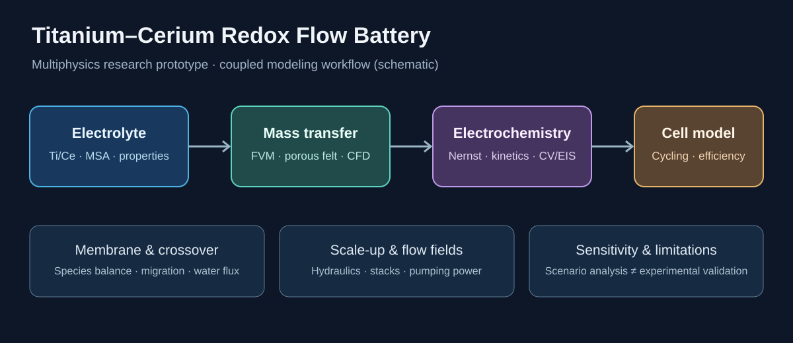

# Titanium–Cerium Redox Flow Battery: Multiphysics Modeling

**From electrolyte chemistry to mass transfer, electrochemical reactor performance, and battery lifetime.**



*Conceptual workflow diagram (not numerical simulation results).*

[](#run-the-project) [](LICENSE) [](#what-this-project-does-and-does-not-show)

A redox flow battery can recover nearly all of the charge it receives and still lose a substantial amount of energy during operation. Where does that energy go? How much comes from slow electrode reactions, limited mass transfer, resistive losses, or the energy needed to pump electrolyte through the cell?

I built this independent, Python-based study to explore those questions for an **aqueous titanium–cerium (Ti–Ce) redox flow battery**. The starting point is the mixed-active-species electrolyte examined by Fu *et al.* (2026). The model connects **electrolyte composition, reactor engineering, transport through porous electrodes, membrane cross-over, charge/discharge performance, and simplified stack and lifetime scenarios**.

This is a **computational research prototype**, not a built battery, a validated digital twin, or a claim of experimental electrochemistry experience. Wherever the literature provides measurements, the repository identifies them; wherever it does not, the calculations are clearly marked as assumptions or sensitivity studies.

> **Primary study:** Fu *et al.*, “A Green Titanium-Cerium Redox Flow Battery with Long-Term Stability via Efficient Capacity Recovery,” *ChemSusChem* **19** (2026), e202502732. [DOI: 10.1002/cssc.202502732](https://doi.org/10.1002/cssc.202502732). The 41-page Supporting Information supplies the experimental cell specifications and several electrochemical/property tables. Neither original PDF is redistributed here.

## Visual overview


**Repository publication status:** This GitHub repository currently contains the research overview and scientific documentation. The complete local project archive (Python solvers, notebooks, numerical outputs and 31 original simulation plots) has **not yet been pushed to this repository**. The links to individual script names and figures below describe the local research project; they become functional when the full archive is uploaded. The schematic above is conceptual rather than a simulation plot.

## The questions behind the model

For **redox flow batteries for renewable energy storage**, energy capacity can be increased through the electrolyte reservoirs while cell and stack design govern power. That makes electrolyte chemistry and battery design inseparable: a formulation that stores more active material may also be more viscous, harder to pump, or slower to react.

This study asks four connected questions:

1. **Mass transfer and flow-field design:** How do convection, diffusion, electrode reaction, and the channel velocity field determine the delivery of Ti/Ce species to an electrode? What is gained in reactant transport, and what is lost to pressure drop and pumping power?
2. **Electrochemical reactor engineering:** How do current density, flow rate, reaction kinetics, and local reactant depletion affect discharge voltage, concentration polarization, and **power density**?
3. **Electrolyte formulation and membrane transport:** How do the reported Ti–Ce redox chemistry, concentration-dependent conductivity and viscosity, and conditional mixed-acid assumptions influence performance? What happens when active species cross the membrane or the electrolyte reservoirs become imbalanced?
4. **Operating conditions and stability:** How do changing charge/discharge rates, voltage cutoffs, temperature-dependent properties, and idealized electrolyte regeneration affect calculated efficiency and capacity? What might change in a multi-cell stack?

These questions overlap with current research on Ti–Ce flow batteries, including electrolyte formulation (type of acid), cross-over, flow-field design, stacking and long-term stability. They are addressed here **at different levels of evidence**, as detailed below; matching a research topic does not imply it has been experimentally resolved.

## Reference battery: what comes from the paper

| Experimental input | Reported value | Where used |
|---|---:|---|
| Geometric electrode area | **9 cm²** (3 × 3 cm) | Cell and reactor calculations |
| Electrolyte in each reservoir | **20 mL** | Reservoir mass balances and cycling |
| Flow rate per half-cell | **20 mL/min** | Hydraulics and transport reference case |
| Positive and negative electrodes | **5 mm heat-treated carbon felt** | Porous-electrode thickness |
| Separator | **N115 proton-exchange membrane** | Membrane reference and resistance |
| Supporting electrolyte | **2.0 M methanesulfonic acid (MSA)** | Reference electrolyte properties |
| Mixed-active initial composition | **0.5 M Ce(III) + 0.5 M Ti(IV)** in each reservoir | Ti/Ce species balances |
| Cell voltage limits | **1.8 V charge / 0.8 V discharge** | Simplified cycling limits |

The electrochemical SI tables also provide *CV-derived apparent* diffusivities and kinetic values (Table S6), along with electrolyte **ionic conductivity and viscosity** versus temperature and concentration (Tables S7–S8). These should not be mistaken for independent measurements of molecular diffusivity inside the actual felt pores. The SI's mRFB recipe paragraph appears inconsistent with its own Figure S10 and the main article; [the discrepancy is documented](DATA_PROVENANCE.md).

## What the code actually models

### 1. Mass transfer, porous electrodes and CFD

The `transport_fv.py` solver applies a conservative, two-dimensional **finite-volume convection–diffusion–reaction** model. It tracks species entering and leaving an idealized channel and reacting at the boundary; its numerical mass balance is explicitly tested. `porous_felt.py` adds a separate **reaction–diffusion** description for carbon felt, including the **Thiele modulus**, effectiveness factor, and reaction penetration depth.

The velocity field can be examined with an educational **D2Q9 lattice-Boltzmann CFD** model (`lbm_flow.py`). Together these allow comparisons of flow rate, apparent diffusion, local concentration, wall flux, and pressure-related trade-offs. They do **not** resolve the three-dimensional microstructure or measured hydraulic permeability of the paper's carbon felt.

*Simulation figure pending repository upload: Simulated Ti(III) concentration in an idealized channel*

*Predicted Ti(III) concentration for an idealized reactive channel; this is a numerical result, not a measured concentration map.*

### 2. Reactor engineering and electrochemical performance

`extensions/reactor.py` connects an axial species balance to **Nernst potentials, Butler–Volmer charge-transfer kinetics, ohmic losses, film mass-transfer limits, and Darcy-type pressure loss**. The objective is to understand why increased current density can reduce useful voltage even when a battery remains highly coulombically efficient.

The reduced-order reactor calculates sensitivity to **operating conditions** such as flow rate, current density, diffusivity assumptions and felt resistance. `design_tradeoffs.py` examines the balance between higher reactant supply and higher **pumping power**. The assumed flow path, internal electroactive area, permeability, and contact resistance are not identified from the published data.

*Simulation figure pending repository upload: Reduced-order reactor polarization scenarios*

*Illustrative electrochemical reactor results under alternative transport assumptions. The curves are not experimental validation.*

### 3. Virtual electrochemistry and battery cycling

The project includes **virtual cyclic voltammetry (CV)** and **virtual electrochemical impedance spectroscopy (EIS)**, as well as a numerical analysis of the *published* CV peak tables. `electrochem_cell.py` simulates reservoir **charge/discharge cycles**, state-of-charge-dependent voltage and **coulombic, voltage and energy efficiency (CE/VE/EE)**. It is useful for studying polarization and comparing operating conditions, not for claiming that CV, EIS or full-cell testing were performed in a laboratory.

A phenomenological discharge-polarization model is compared with approximate points read from Figure 6c of Fu *et al.* `calibrate_transport.py` checks the fit, holdout points from the same graph, and parameter identifiability. The fitted curvature parameter is **not** a measured limiting current or a uniquely identified felt mass-transfer coefficient.

*Simulation figure pending repository upload: Approximate published discharge-curve fit*

*The reference points were visually digitized; they are not raw voltmeter or cycler data.*

### 4. Electrolyte chemistry, acid formulation and precipitation evidence

`electrolyte_chem.py` uses Ti/Ce redox-state balances and formal Nernst relationships, while `extensions/chemistry.py` explores **conditional MSA/H₂SO₄ mixed-acid electrolyte formulation** scenarios. Published conductivity and viscosity data are included for the **MSA-only** reference electrolyte. A separate evidence-based module (`extensions/evidence_thermodynamics.py`) compares **Ce(III)/Ce(IV) solubility** with literature-reported limits at specified acid compositions, and illustrates **Ce–sulfate complexation** only in the published conditional medium.

**Electrolyte precipitation is an open gap, not a solved prediction.** The model has no validated high-ionic-strength activity model, solid-phase solubility products, or complete Ti/Ce–MSA–sulfate equilibrium constants for arbitrary mixed-acid conditions. Consequently, its flags are **literature-constrained solubility screening**, not predictions of precipitate amount, onset temperature, or a validated stable operating window. See [thermodynamic evidence and limitations](THERMODYNAMICS_EVIDENCE.md).

*Simulation figure pending repository upload: Evidence-constrained cerium solubility screening*

*Only acid recipes for which source data are available are screened; white regions are not predictions.*

### 5. Membrane cross-over, regeneration, scale-up and lifetime

`extensions/membrane.py` combines a Fick-type permeation term, **illustrative electromigration**, and prescribed water transfer while conserving total Ti and Ce inventory across two reservoirs. Its reference Ce permeability comes from the SI, but Ti permeability, membrane electric field and water flux remain assumed.

`extensions/lifetime.py` separates **reversible capacity imbalance** from illustrative irreversible ageing and tests idealized **electrolyte regeneration / remixing** strategies. `extensions/stack.py` explores **scale-up and stacking** with series-connected cell voltages, simplified hydraulic branches, nonuniform flow and pump consumption. These are engineering sensitivity models, **not** validated 3,721-cycle predictions or hardware stack designs.

*Simulation figure pending repository upload: Hypothetical long-term electrolyte remixing*

*Regeneration and capacity fade here are scenarios with assumed rates, not a reconstruction of the paper's measured lifetime trace.*

## Research themes and evidence at a glance

The repository covers the following **electrochemistry and electrochemical engineering** subjects. “Modeled” means code exists and can be run; it does not imply a physical experiment.

| Research topic | Status in this repository |
|---|---|
| **Mass transfer / reactor engineering** | **Numerically modeled:** 2D transport, porous-felt reaction–diffusion, reduced-order flow reactor and hydraulic losses |
| **Flow field design / electrode geometry** | **Illustrative CFD and porous-electrode scenarios:** not the actual cell CAD or fabricated electrode |
| **Ti–Ce redox chemistry / electrolyte formulation (type of acid)** | **Paper-grounded MSA reference + conditional mixed-acid scenarios:** no validated formulation optimization |
| **Charge/discharge rate, operating conditions and power density** | **Simulated:** polarization, cycling, energy efficiency, current-density/flow sensitivities |
| **Membrane and cross-over** | **Scenario-based transport:** Ce reference permeability; electric field, Ti crossover and water transport are not independently measured |
| **Electrolyte precipitation / solubility / stability** | **Evidence screening only:** no full equilibrium precipitation or chemical stability prediction |
| **Scale-up / stacking** | **Reduced-order illustrative network model:** no experimentally tested multi-cell stack |
| **Long-term stability / battery lifetime / regeneration** | **Conditional ageing and ideal-remixing scenarios:** not calibrated to the published 3,721 cycles |
| **Electrochemical experiments and electrode surface functionalization** | **Not performed:** CV/EIS are simulated; no physical tests, surface treatments or electrocatalysts are claimed |

For a detailed one-to-one mapping from research keywords to scripts, outputs and scientific caveats, see [**Research keyword & evidence map**](RESEARCH_KEYWORD_MAP.md).

## Verification and limitations

The local verification suite has **66 passing automated tests**. These check numerical behavior and bookkeeping; they do not establish the physical accuracy of unmeasured coefficients.

- **Mass conservation:** maximum relative species-balance residual of approximately **2 × 10⁻¹⁴** in the reported finite-volume sweep.
- **Discharge-curve inverse analysis:** approximately **0.026 V** RMSE on four points held out from the *same visually digitized article figure*. This is a consistency check, **not** independent experimental validation.
- **Sensitivity and identifiability:** excluding a high-current endpoint substantially changes inferred transport curvature. Different combinations of kinetics, ohmic resistance and transport can explain similar voltage trends.
- **Thermodynamic evidence:** source-limited Ce solubility and medium-specific complexation checks; no validated Ti/Ce mixed-acid precipitation thermodynamics.

The most important missing data for stronger validation are measured flow-field geometry, felt porosity/tortuosity and electroactive area, pressure drop versus flow rate, membrane transport parameters, raw voltage/current/time traces across SOC and temperature, and verified speciation/solubility equilibria. These are research needs, not hidden fit parameters.

## Run the project

Python **3.11 or newer** is recommended. The workflow is CPU-only; no CUDA/GPU is required.

```bash
python -m venv .venv
source .venv/bin/activate    # on Windows, use .venv\Scripts\activate
python -m pip install -r requirements.txt
python run_all.py
python -m pytest -q tests/
```

If you already use a conda environment on Linux Mint:

```bash
conda activate science
python -m pip install -r requirements.txt
OPENBLAS_NUM_THREADS=1 python run_all.py
OPENBLAS_NUM_THREADS=1 python -m pytest -q tests/
```

`run_all.py` reproduces the integrated model, polarization analysis, hydraulic trade-offs, conditional mixed-acid reactor/membrane/stack/lifetime extensions, and evidence-based Ce solubility analysis. Add `--full` to increase the integrated-model grid resolution. Individual scripts and notebooks can also be run separately.

**Where to look:** `figures/` and `outputs/` contain the integrated model results; `validation_figures/` and `validation_outputs/` hold the inverse-model checks; `extended_figures/` and `extended_outputs/` show engineering scenarios; `thermo_evidence/` contains the evidence-limited chemistry work.

## Explore the complete results

See the [**figure gallery**](docs/FIGURE_GALLERY.md) to browse **all 31 generated charts**, organized by mass transfer, electrochemical validation, engineering scenarios, and literature-grounded thermodynamic screening. Each figure is stored in the repository and linked with a relative path so it renders on GitHub.

## Repository guide

| File / folder | Purpose |
|---|---|
| [`transport_fv.py`](transport_fv.py), [`porous_felt.py`](porous_felt.py), [`lbm_flow.py`](lbm_flow.py) | Mass transfer, porous electrode and idealized CFD |
| [`extensions/reactor.py`](extensions/reactor.py), [`design_tradeoffs.py`](design_tradeoffs.py) | Coupled reactor / hydraulic trade-offs |
| [`electrochem_cell.py`](electrochem_cell.py), [`cv_virtual.py`](cv_virtual.py) | Battery cycling, simulated CV and EIS |
| [`extensions/chemistry.py`](extensions/chemistry.py), [`extensions/evidence_thermodynamics.py`](extensions/evidence_thermodynamics.py) | Mixed-acid scenario and source-limited solubility/complexation |
| [`extensions/membrane.py`](extensions/membrane.py) | Membrane permeation, conditional electromigration and water transport |
| [`extensions/stack.py`](extensions/stack.py), [`extensions/lifetime.py`](extensions/lifetime.py) | Stacking, scale-up and lifetime/regeneration scenarios |
| [`calibrate_transport.py`](calibrate_transport.py) | Figure 6c approximation, inverse fit, identifiability |
| [`TiCe_Integrated_Study.ipynb`](TiCe_Integrated_Study.ipynb), [`TiCe_Gap_Extensions.ipynb`](TiCe_Gap_Extensions.ipynb), [`TiCe_Thermodynamics_Evidence.ipynb`](TiCe_Thermodynamics_Evidence.ipynb) | Readable notebooks |
| [`DATA_PROVENANCE.md`](DATA_PROVENANCE.md), [`MODEL_COVERAGE.md`](MODEL_COVERAGE.md) | Sources, assumptions and detailed method coverage |

## Attribution and license

This project is an **independent secondary analysis and numerical modeling exercise**. It is not affiliated with the authors of the source study, the University of Antwerp, or its ELCAT group. All results from Fu *et al.* remain attributed to the original researchers; figures in this repository are generated by this code rather than copied from the journal.

The original project code and documentation are provided under the [MIT License](LICENSE). Third-party publications and their scientific results are not relicensed.